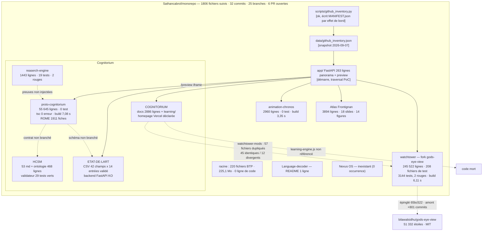

# Audit technique indépendant — Sathancabrol (monorepo + 8 dépôts)

**Version 2 — enrichie** (2026-10-11, UTC). Remplace la v1 du même jour : benchmark étendu à 25 dépôts mesurés, ajout de la valeur différenciante, de la traction mesurée, de la checklist README/docs, des fichiers prêts à copier (annexes) et de la revue factuelle des options d'outillage.
**Périmètre** : `Sathancabrol/monorepo` (checkout local, commit `a18938d4f309c3de753c3cbe587ad06a111ecbea`, arbre inchangé depuis : `git status --short` → `?? AUDIT.md` uniquement) + métadonnées des 9 dépôts publics du compte.
**Mode** : audit uniquement. Aucune modification de code, aucune branche, aucun commit, aucune PR. Écriture unique : ce fichier.
**Environnement de test** : Linux (sandbox), Python 3.11.2, Node v22.22.3, npm 10.9.8, git 2.39.5. Pas de navigateur, pas de GPU, aucune clé API tierce. Accès réseau sortant limité à `github.com`, `api.github.com`, `codeload.github.com`, `registry.npmjs.org`, `pypi.org`, `files.pythonhosted.org` — les blogs et `docs.github.com` sont inaccessibles, ce qui borne le benchmark (voir §4).
**Étiquettes** : `[VÉRIFIÉ]` observé ce cycle · `[DÉDUIT]` déduit de faits vérifiés · `[HYPOTHÈSE]` plausible non établi · `[NON VÉRIFIABLE]` hors de portée.

### Reprise par un autre agent (bloc de passation)

- **État du dépôt au moment de l'audit** : commit `a18938d4f309c3de753c3cbe587ad06a111ecbea`, branche `arena/f3c2cd12-monorepo`, aucun fichier suivi modifié. Ce fichier est le seul ajout.
- **Ce qui a été exécuté et peut être rejoué à l'identique** : `cd projects/watchtower && npm ci --ignore-scripts && node scripts/run-unit-tests.mjs` (3 144 tests, 2 échecs, exit 1) · `python -m pytest -q` dans `projects/HCSM/validator` (29 passed) et dans `projects/reaserch-engine` (2 failed, 17 passed) · `python -c "import app.main"` dans `projects/ETAT-DE-LART-PSYCHOLOGIE` (RuntimeError) · `python scripts/validate_entry.py --file data/nodes_etat_art_psychologie.csv` (PASSED) · `uvicorn app.main:app` puis les 4 PoC de traversée de §3 · `npx tsc --noEmit` et `npx vite build --base=./` dans les trois modules Vite.
- **Dépendances nécessaires** : Node 22.x (24.14+ pour watchtower), Python 3.11, `pip install PyYAML pytest fastapi==0.110.0 "uvicorn[standard]==0.29.0" jinja2==3.1.4 python-multipart==0.0.9 pandas`.
- **Ce qui reste ouvert** : §13 (10 questions), et les points `[NON VÉRIFIABLE]` de §11 — rendu navigateur, qualité des sorties Gemini, comportement Windows, démo Vercel de COGNITORIUM, trafic des dépôts, exactitude des 128 URL de Frontignan, coût réel des API.
- **Ce qui n'a pas été fait volontairement** : aucune correction de code, aucune purge d'historique, aucune création d'issue ou de PR. Les fichiers des annexes A à F sont fournis dans ce document et n'ont pas été écrits dans le dépôt.
- **Accès utiles** : le jeton GitHub de la sandbox a un accès API au compte entier (`gh api repos/Sathancabrol/<r>`), pas seulement au dépôt cloné.


---

## 1. Résumé exécutif

1. Trois produits déclarés, trois maturités différentes : **Atlas Frontignan** est un livrable terminé et reproductible ; **Cognitorium** est un assemblage de 5 briques réelles mais non câblées, sans test sur le produit ; **Carré d'As** est un conteneur dont un module sur six (« Nexus OS ») n'existe dans aucun dépôt.
2. Ce qui est réel et mesuré : 1 911 fiches ROME + 17 920 associations compétences→ROME dans `proto-cognitorium`, 3 144 tests dans `watchtower` (3 141 verts), 29 tests verts dans `HCSM`, une base bibliographique 42 champs × 14 entrées validée, 9 figures matplotlib régénérables.
3. Ce qui est cassé : le backend `ETAT-DE-LART` ne démarre pas (`RuntimeError: Directory 'app/static' does not exist`), 2 tests watchtower rouges, 2 tests reaserch-engine rouges, une traversée de chemin reproductible dans `app/main.py`, `learning-engine.js` jamais chargé.
4. Traction mesurée : **0 étoile, 0 fork, 0 abonné, 1 issue ouverte** sur les 9 dépôts ; aucune release ; aucune CI à la racine du monorepo ; 6 PR ouvertes non traitées, 25 branches.
5. Verdicts : Cognitorium **faisable en réduisant le périmètre** (3-8 jours-personne pour une démo unique, confiance faible) ; Carré d'As **à repenser** comme périmètre avant d'être un produit ; Atlas Frontignan **faisable tel quel**.
6. Actions n°1 : (a) sortir les données personnelles de tiers des dépôts publics et purger l'historique ; (b) rendre les suites vertes et les exécuter en CI sur Windows ; (c) réduire Cognitorium à un parcours démontrable unique et afficher le mode dégradé sans clé Gemini.
7. Le benchmark (25 dépôts mesurés) donne un écart net : release taguée 23/25 chez eux, 0/9 ici ; CI 21/25, 0/9 ici ; licence SPDX claire 20/25, 2/9 ici.
8. La valeur différenciante existe et est vérifiable (référentiel ROME embarqué, échelle épistémique, courbe d'oubli, globe sans clé) ; elle n'est exposée nulle part : 2 modules sur 9 n'ont pas de README, aucun n'a de description GitHub exploitable, aucun topic.
9. L'option « un repo par session » avancée ailleurs est fausse dans cet environnement : l'API GitHub du compte est accessible depuis la sandbox (les 9 dépôts ont été interrogés ce cycle) ; seul l'exécution de code est limitée au dépôt cloné.
10. Ce qui n'a pas pu être vérifié : rendu navigateur, qualité des sorties Gemini, comportement réel sous Windows, exactitude des 128 URL citées par le rapport Frontignan, contenu sémantique des PDF scannés.

---

## 2. Carte de l'écosystème



Flèches pleines = dépendance exécutée ou vérifiée. Pointillés = lien déclaré dans la documentation, non implémenté.

---

## 3. Tableau de scores (0 = absent · 3 = au niveau des meilleurs)

Critères : **P** clarté produit · **D** démontrabilité · **A** architecture · **Q** qualité du code · **I** données et IA · **S** sécurité et légal · **Doc** documentation · **O** opérations · **T** traction.

| Module | P | D | A | Q | I | S | Doc | O | T | /27 |
|---|---|---|---|---|---|---|---|---|---|---|
| `app/` interface unifiée | 1 | 2 | 2 | 1 | 1 | 1 | 2 | 1 | 0 | 11 |
| watchtower | 2 | 2 | 2 | 2 | 2 | 2 | 3 | 2 | 1 | 18 |
| proto-cognitorium | 2 | 2 | 2 | 1 | 2 | 0 | 1 | 2 | 0 | 12 |
| COGNITORIUM | 1 | 1 | 1 | 0 | 1 | 0 | 3 | 0 | 1 | 8 |
| ETAT-DE-LART-PSYCHOLOGIE | 2 | 1 | 1 | 1 | 3 | 1 | 2 | 0 | 0 | 11 |
| HCSM | 2 | 1 | 2 | 2 | 2 | 2 | 3 | 1 | 0 | 15 |
| reaserch-engine | 1 | 1 | 2 | 2 | 2 | 1 | 2 | 0 | 0 | 11 |
| animation-chronos | 1 | 2 | 2 | 1 | 1 | 1 | 0 | 2 | 0 | 10 |
| Atlas Frontignan | 2 | 2 | 2 | 1 | 2 | 1 | 3 | 1 | 1 | 15 |
| Language-decoder | 0 | 0 | 0 | 0 | 0 | 1 | 0 | 0 | 0 | 1 |
| dossier BTP (racine) | 0 | 0 | 0 | 0 | 1 | 0 | 2 | 0 | 0 | 3 |

### Preuves (mesures de ce cycle)

- **Taille et code** : `git ls-files` = 1 806 fichiers suivis ; sommes mesurées par `du -b` : racine 225,1 Mo, `projects/` 180,9 Mo, `docs/` 4,0 Mo. Arbre de travail hors `.git` = 414 Mo, `.git` = 306 Mo. Lignes source hors `dist`/`node_modules` : watchtower 245 522 · proto-cognitorium 55 645 · COGNITORIUM 36 615 · frontignan 3 894 · animation-chronos 2 960 · ETAT 2 945 · HCSM 1 855 · reaserch-engine 1 443 · Language-decoder 0. `[VÉRIFIÉ]`
- **Tests** : watchtower `node scripts/run-unit-tests.mjs` après `npm ci` → **3 144 tests, 3 141 pass, 2 fail, 1 skipped**, code de retour **1**, 110,3 s. HCSM `pytest -q` → **29 passed**. reaserch-engine `pytest -q` → **2 failed, 17 passed** (`test_agents.py::test_researcher_uses_injected_retriever` IndexError ; `test_research_strategy.py::test_contradictions_are_prioritized`). Fichiers de test : watchtower 208, reaserch-engine 12, HCSM 1, **0 pour les six autres modules**. `[VÉRIFIÉ]`
- **Les 2 échecs watchtower** portent sur un ajout du fork : `src/mapStackController.js:47` déclare `id: 'ign-ortho'`, absent de la table de classification des câbles et des alias vocaux (`src/data/telegeographySubmarineCables.test.mjs:147`, `src/voice/gevActions.test.mjs:22`). `[VÉRIFIÉ]`
- **Backend ETAT** : `python -c "import app.main"` → `RuntimeError: Directory 'app/static' does not exist` (`app/main.py:18`), code de retour 1. Aucun `requirements.txt` alors que `app/database.py` importe `pandas`. `[VÉRIFIÉ]`
- **Données ETAT** : `scripts/validate_entry.py` → « Validation PASSED », trust moyen 73,2 (min 42, max 90), 42 colonnes, 14 entrées, 14 DOI uniques. `[VÉRIFIÉ]`
- **Traversée de chemin** (`app/main.py:74` `safe_resolve`) : `GET /api/fs/list?project=..&path=` → **200** ; `GET /api/fs/file?project=..&path=.git/config` → **200**, 548 octets ; `GET --path-as-is /preview/%2e%2e/README.md` → **200**. Escalade hors de la racine du dépôt → **400**. Portée : lecture de tout fichier **dans la racine du dépôt**, y compris `.git/`. `[VÉRIFIÉ]`
- **Builds** : `npx vite build --base=./` → watchtower exit 0 (6,11 s), proto-cognitorium exit 0 (7,08 s, chunk 6 727,48 kB), animation-chronos exit 0 (3,35 s) ; `npx tsc --noEmit` → 0 erreur sur proto-cognitorium et animation-chronos. Les `dist/` committés portent les mêmes empreintes que les builds frais. `[VÉRIFIÉ]`
- **Documentation** : README absent pour `proto-cognitorium` et `animation-chronos` ; `.gitignore` absent pour COGNITORIUM, frontignan, Language-decoder ; `LICENSE` présent uniquement dans watchtower (MIT amont) et HCSM (CC-BY-4.0) ; `SECURITY.md`/`CONTRIBUTING.md`/CI uniquement dans watchtower. `[VÉRIFIÉ]`
- **Traction** : voir §6. `[VÉRIFIÉ]`

---

## 4. Benchmark — 25 dépôts comparables mesurés le 2026-10-11

**Méthode** : pour chaque dépôt, requêtes `api.github.com` (métadonnées, `contents/.github/workflows`, `contents/SECURITY.md`, `contents/CONTRIBUTING.md`, `contents/.github/ISSUE_TEMPLATE`, `releases/latest`). Source primaire. `docs.github.com` et les articles tiers étant inaccessibles depuis cet environnement, aucune recommandation issue d'un blog n'est reprise : la grille ci-dessous est **déduite** des fréquences mesurées.

### 4.1 Mesures

| Dépôt | Étoiles | Licence | Dernier push | Workflows | SECURITY | CONTRIBUTING | Issue templates | Release |
|---|---|---|---|---|---|---|---|---|
| vasturiano/force-graph | 2 141 | MIT | 2026-09-28 | 0 | non | non | 2 | non |
| cytoscape/cytoscape.js | 11 234 | MIT | 2026-10-06 | 5 | non | oui | 2 | oui |
| gephi/gephi | 6 664 | GPL-3.0 | 2026-10-10 | 3 | oui | oui | 3 | oui |
| obsidianmd/obsidian-releases | 22 150 | **aucune** | 2026-10-11 | 2 | non | non | 0 | oui |
| logseq/logseq | 45 209 | AGPL-3.0 | 2026-10-11 | 23 | non | oui | 2 | oui |
| neo4j/neo4j | 17 293 | GPL-3.0 | 2026-10-09 | 0 | non | oui | 2 | oui |
| lanmaster53/recon-ng | 5 987 | GPL-3.0 | 2026-10-05 | 0 | non | non | 0 | non |
| smicallef/spiderfoot | 23 317 | MIT | 2026-04-13 | 2 | non | non | 0 | oui |
| jivoi/awesome-osint | 30 157 | NOASSERTION | 2026-10-11 | 0 | non | oui | 0 | oui |
| nrwl/nx | 29 400 | MIT | 2026-10-11 | 14 | oui | oui | 3 | oui |
| vercel/turborepo | 31 188 | MIT | 2026-10-11 | 13 | oui | oui | 3 | oui |
| pnpm/pnpm | 36 783 | MIT | 2026-10-11 | 29 | oui | oui | 3 | oui |
| calcom/cal.com (→ cal.diy) | 48 952 | MIT | 2026-09-26 | 50 | oui | oui | 3 | oui |
| n8n-io/n8n | 207 012 | NOASSERTION | 2026-10-11 | 111 | oui | oui | 2 | oui |
| supabase/supabase | 111 366 | Apache-2.0 | 2026-10-11 | 54 | non | oui | 0 | oui |
| electron/electron | 123 279 | MIT | 2026-10-11 | 53 | oui | oui | 4 | oui |
| tauri-apps/tauri | 111 766 | Apache-2.0 | 2026-10-11 | 23 | oui | non | 4 | oui |
| excalidraw/excalidraw | 133 651 | MIT | 2026-10-11 | 11 | non | oui | 0 | oui |
| Significant-Gravitas/AutoGPT | 187 523 | NOASSERTION | 2026-10-11 | 36 | oui | oui | 2 | oui |
| crewAIInc/crewAI | 59 573 | MIT | 2026-10-10 | 16 | non | non | 3 | oui |
| openai/openai-agents-python | 29 968 | MIT | 2026-10-08 | 10 | oui | oui | 4 | oui |
| microsoft/graphrag | 36 289 | MIT | 2026-10-08 | 12 | oui | oui | 4 | oui |
| stanford-oval/storm | 31 605 | MIT | 2025-09-30 | 2 | non | oui | 1 | oui |
| langchain-ai/langgraph | 43 074 | MIT | 2026-10-11 | 17 | non | non | 3 | oui |
| bilawalsidhu/gods-eye-view | 51 332 | NOASSERTION (texte MIT) | 2026-10-10 | 1 | oui | oui | 3 | oui |

**Fréquences calculées sur ces 25 dépôts** `[VÉRIFIÉ]` : release taguée **23/25** · ≥ 1 workflow CI **21/25** · licence SPDX claire **20/25** · issue templates **19/25** · `CONTRIBUTING.md` **18/25** · `SECURITY.md` **12/25**.

### 4.2 Grille retenue, adaptée à un projet solo en phase prototype

Les 25 dépôts ci-dessus sont des projets à équipe. Trois critères mesurés sont écartés comme non pertinents à ton stade : `CONTRIBUTING.md` (pas de contributeur), `CODE_OF_CONDUCT`, `SECURITY.md` (pas d'utilisateur externe). Sont retenus, avec la fréquence observée et la transposition solo :

| # | Pratique | Fréquence | Transposition solo | Coût |
|---|---|---|---|---|
| 1 | Licence explicite à la racine | 20/25 | une `LICENSE` par dépôt + `NOTICE` d'attribution pour le fork | 2-4 h |
| 2 | CI qui exécute tests + build | 21/25 | 1 workflow, 5 jobs (watchtower, proto, animation, HCSM, reaserch) | 0,5-1 j |
| 3 | Release/tag même léger | 23/25 | `git tag v0.1.0` + `gh release create` avec le `dist/` ou une capture | 1 h |
| 4 | README avec pitch + quickstart copiable | 25/25 ont un README | pitch en 3 phrases, 1 commande de lancement, 1 capture | 2 h |
| 5 | Fichier de dépendances par module exécutable | — | `requirements.txt` pour ETAT-DE-LART | 15 min |
| 6 | `.gitignore` et `.env.example` | — | 3 `.gitignore` manquants, 1 `.env.example` pour le backend | 30 min |
| 7 | Scan de secrets dans l'historique | — | gitleaks (v8.30.1, MIT) en local + en CI | 1 h |
| 8 | Description et topics GitHub | — | 9 dépôts sans description exploitable, 0 topic | 30 min |
| 9 | Issue templates | 19/25 | 1 template « bug avec commande + sortie » | 30 min |
| 10 | Fichier de décisions | — | `DECISIONS.md` (annexe F) | 15 min |

### 4.3 Écart avec tes dépôts

| Pratique retenue | Benchmark | Tes 9 dépôts | Preuve |
|---|---|---|---|
| Licence SPDX claire | 20/25 | **2/9** (watchtower MIT amont, HCSM CC-BY-4.0) | `gh api repos/Sathancabrol/<r>` → `aucune` pour 7 dépôts |
| CI exécutant les tests | 21/25 | **0/9** dans le monorepo (le `ci.yml` de watchtower n'est pas à la racine, donc jamais déclenché) | aucun `.github/workflows` à la racine |
| Release taguée | 23/25 | **0/9** | `releases/latest` → 404 sur les 9 dépôts |
| README | 25/25 | **7/9** modules (absent : proto-cognitorium, animation-chronos) | `git ls-files projects/<m>/README.md` → 0 |
| `.gitignore` | — | **7/10** (absent : COGNITORIUM, frontignan, Language-decoder) | test de présence de fichier |
| Description GitHub | — | 4 descriptions de 1 à 6 mots (« proto de l'app », « animation »), 5 sans description, **0 topic** | `gh api ... --jq .description,.topics` |
| Scan de secrets | — | aucun ; 1 faux positif connu (`dist/cesium/Cesium.js`) à mettre en allowlist | scan des 1 806 fichiers suivis |
| Issue templates | 19/25 | **0/9** | `contents/.github/ISSUE_TEMPLATE` → 404 |

---

## 5. Pertinence et valeur différenciante

### 5.1 Cognitorium

**Actifs mesurés, non reproductibles ailleurs à l'identique** `[VÉRIFIÉ]` :
- `src/data/romeData.ts` (5 674 072 octets) : **1 911 fiches ROME** et **17 920 associations compétence→ROME**, générées par `scripts/build_rome_data.py` à partir des XLSX France Travail (fiches ROME, arborescence des compétences, référentiel FORMACODE). Les bibliothèques de visualisation comparables (`force-graph` 2 141 étoiles, `cytoscape.js` 11 234, `gephi` 6 664) fournissent le rendu, **pas** de référentiel métier français : c'est un actif de données, pas un actif de code.
- `src/utils/epistemics.ts` (124 lignes) : `EpistemicLevel`, `EPISTEMIC_SCALE`, `getEpistemicLevel` — gradation du statut épistémique d'une affirmation.
- `src/utils/decay.ts` (99 lignes) : `calculateSkillVitality`, `getEstimatedReactivationEffort`, `getVitalityStatus` — décroissance temporelle des compétences.
- `src/utils/romeMatching.ts` (361 lignes) : `computeFicheMatch`, `computeAllRomeMatches`, `searchRomeFiches`, `COMPATIBILITY_LABELS` — matching explicable.
- Base bibliographique 42 champs avec Trust Factor, triangulation ≥ 3 sources, validation automatique (`validate_entry.py`).
- Ontologie HCSM (468 lignes YAML) + validateur d'admissibilité (29 tests).

**Ce qui se démarque réellement** `[DÉDUIT]` des mesures ci-dessus : l'association d'un référentiel métier national (ROME/FORMACODE) à une dimension temporelle (décroissance) et à une échelle épistémique. Aucun des 6 outils de graphe comparés ne couvre ce trio ; ils sont des moteurs de rendu.

**Ce qui affaiblit la pertinence** `[VÉRIFIÉ]` : 0 test sur le module ; sans `GEMINI_API_KEY`, `POST /api/distill-experience` renvoie HTTP 200 avec `source:"local_engine"` et un contenu **identique quel que soit le texte envoyé** (`server.ts:50-90`) — la fonction présentée comme de l'extraction IA est un gabarit ; `ROME_CODE_SKILLS` compte 1 909 clés pour 1 911 fiches (2 fiches sans compétences) ; aucun README ; aucune capture, aucune démo publiée depuis ce dépôt.

### 5.2 Watchtower (module du Carré d'As)

**Apport du fork, mesuré** `[VÉRIFIÉ]` : `src/startGate.js` (468 lignes, écran gratuit/payant), `src/voice/freeVoice.js` (296 lignes, commande vocale sans OpenAI), `src/mapStackController.js:89` tuiles `basemaps.cartocdn.com/rastertiles/voyager` en remplacement d'OSM, `src/mapStackController.js:47` couche `ign-ortho`, `src/locations.js:409` géocodage `photon.komoot.io`. L'axe « chaque fonction payante a son équivalent sans clé » est donc réel et localisable dans le code.

**Limite** `[VÉRIFIÉ]` : l'amont `bilawalsidhu/gods-eye-view` est à 51 332 étoiles, release `v0.2.1`, 1 workflow CI, et le fork est épinglé sur `65bc522` (2026-09-01) alors que l'amont est **+801 commits** ahead. Les deux fichiers ajoutés par le fork les plus structurants (`startGate.js`, `freeVoice.js`) n'ont **aucun fichier de test**. `package.json` porte toujours `name: "gods-eye-view"`, `author: "Bilawal Sidhu"`, `homepage` amont : le fork n'est pas rebrandé.

### 5.3 Atlas Frontignan

**Périmètre déduit du contenu** `[VÉRIFIÉ]` (14 Mo, 3 894 lignes Python) : `rapport-frontignan-analyse-territoriale.md` (« RAPPORT D'ANALYSE TERRITORIALE MULTIMODAL »), `vision-frontignan-2026-2040.md`, `dossier-prevision-palanquee-fablab-ia-locale-2026.md`, deck `index.html` de **18 slides**, 14 figures, 4 scripts générateurs, 4 visuels. Le module « climat El Niño & Thau » existe uniquement dans la PR #10 (draft, `climat-el-nino-thau.html` + 5 lignes de README).

**Valeur** `[DÉDUIT]` : méthode reproductible (script → figure → deck autonome) et corpus sourcé (249 occurrences de liens, **128 URL uniques**). C'est un livrable de conseil, pas un produit logiciel : aucun service, aucune base de données, aucune interface.

---

## 6. Traction mesurée

| Dépôt | Étoiles | Forks | Abonnés | Issues ouvertes (hors PR) | Créé | Dernier push |
|---|---|---|---|---|---|---|
| monorepo | 0 | 0 | 0 | 1 (#6 « Implementer le MVP de l'agent de continuité de travail ») | 2026-09-07 | 2026-10-11 |
| watchtower | 0 | 0 | 0 | 0 | 2026-09-01 | 2026-10-11 |
| proto-cognitorium | 0 | 0 | 0 | 0 | 2026-08-24 | 2026-10-11 |
| COGNITORIUM | 0 | 0 | 0 | 0 | 2026-08-02 | 2026-10-11 |
| ETAT-DE-LART-PSYCHOLOGIE | 0 | 0 | 0 | 0 | 2026-08-24 | 2026-10-11 |
| HCSM | 0 | 0 | 0 | 0 | 2026-08-25 | 2026-10-11 |
| reaserch-engine | 0 | 0 | 0 | 0 | 2026-08-26 | 2026-10-11 |
| animation-chronos | 0 | 0 | 0 | 0 | 2026-09-02 | 2026-10-11 |
| Language-decoder | 0 | 0 | 0 | 0 | 2026-08-30 | 2026-10-11 |

`[VÉRIFIÉ]` via `gh api repos/Sathancabrol/<r>`. Lecture à froid : aucune validation externe, aucune communauté, aucun retour utilisateur mesurable. Deux signaux non mesurables ici : `COGNITORIUM` déclare `homepage: https://cognitorium-omega.vercel.app` (hors des hôtes accessibles → `[NON VÉRIFIABLE]` : je ne peux pas confirmer que la démo est en ligne) ; l'API `traffic/views` renvoie 403 « Resource not accessible by integration », donc les vues et clonages sont inconnus.

**Conséquence pour la priorisation** `[DÉDUIT]` : avec 0 étoile et 1 issue, le critère « traction » ne peut pas départager les projets. Le seul arbitrage disponible est la démontrabilité : ce qui se lance en une commande et montre quelque chose à un tiers en moins de 5 minutes.

---

## 7. Fiches de faisabilité

### 7.1 Cognitorium

**Ce qui existe réellement** `[VÉRIFIÉ]` : front React 19 buildé (exit 0, 7,08 s), typage propre (`tsc --noEmit` 0 erreur), `dist/` committé à jour, serveur Express démarré (`GET /` 200, première réponse 1,6 s après lancement), 3 endpoints IA, référentiel ROME complet, ontologie + validateur (29 tests), base bibliographique validée, orchestrateur de recherche (19 tests dont 2 rouges).

**Ce qui manque pour un MVP démontrable** : un parcours unique écrit (aucun README, aucune spec de parcours) ; au moins un test de non-régression sur ce parcours ; l'affichage explicite du mode sans clé ; la correction du backend ETAT si la base bibliographique entre dans la démo.
**Ce qui manque pour un usage par des tiers** : authentification, persistance serveur (les données sont en `localStorage` selon `projects/COGNITORIUM/docs/etat-des-lieux/09-synthese.md`), traitement RGPD, licence, hébergement, suivi de coût Gemini.

**Risques**

| Risque | Probabilité | Gravité | Preuve |
|---|---|---|---|
| Données personnelles de tiers publiques | certaine (état actuel) | élevée | 4 CV avec e-mail et téléphone dans `projects/proto-cognitorium/raw/` (62 Mo), dépôt public |
| Périmètre non borné | élevée | élevée | 55 645 lignes, 68 fichiers source, 0 test, 6 profils (`amelie`, `gianni`, `nathan`, `pierre`, `student`, `transition`) |
| Confusion produit due au mock `local_engine` | moyenne | moyenne | réponse 200 à contenu fixe, `server.ts:50-90` |
| Coût Gemini non plafonné ni mesuré | élevée | moyenne | aucune instrumentation de coût dans le dépôt ; `docs/audits/costs/001-costs.md` renvoie à un relevé inexistant |
| Dispersion | certaine | moyenne | 25 branches, 6 PR ouvertes, 9 dépôts |

**Verdict : faisable en réduisant le périmètre.** Effort : **3 à 8 jours-personne** en solo pour une démo unique (hypothèses : aucune fonctionnalité nouvelle, périmètre figé à un parcours « profil → graphe → matching ROME », données de démo préparées à l'avance, pas de backend). Confiance **faible** sur la borne haute : 0 test existant, donc aucune estimation de la dette cachée.

**Dépendances** : à partager = le validateur HCSM (contrôle de sortie), la base 42 champs (contenu), le référentiel ROME (données). À découpler = watchtower (cycle amont indépendant) et Frontignan (livrable).

### 7.2 Carré d'As (global)

**Correspondance déclarée / réelle** `[VÉRIFIÉ]`

| Module déclaré | Réalité | Preuve |
|---|---|---|
| Proto Cognitorium | existe | `projects/proto-cognitorium/` (86 Mo) |
| Watchtower | existe | `projects/watchtower/` (52 Mo, 3 144 tests) |
| État de l'art | existe, backend KO | `projects/ETAT-DE-LART-PSYCHOLOGIE/` |
| Nexus OS | **inexistant** | 0 occurrence de « nexus » hors un jeu de données `datacenters.geojsonl` et un dossier frontignan |
| Atlas Frontignan | partiel | livrable sur `main` + module climat en PR #10 draft |
| Module BTP | existe, sans code | 220 fichiers, 225,1 Mo, 0 ligne de code |

Les noms « Carré d'As », « Atlas Frontignan », « Module BTP » n'apparaissent **nulle part** dans le dépôt. Le vocabulaire produit et le dépôt ne correspondent pas.

**Verdict : à repenser** — le périmètre, pas le code. Effort : **1 à 2 jours-personne** pour écrire la définition du produit (6 modules ou moins, avec pour chacun : utilisateur, problème, état, décision continuer/arrêter) et l'exécuter (fermer les PR, archiver, sortir le BTP de Git). Confiance **moyenne**.

**Risques** : poids (414 Mo d'arbre, 306 Mo de `.git`, 16 fichiers suivis > 5 Mo) ; ambiguïté de périmètre ; travail non intégré (6 PR, dont #3 « audit : état des lieux complet 2026-10 (9 projets, 52 findings) » et #4 « Bone — agent IA South Park pour Discord Olympus », sans rapport avec les trois produits) ; effet de bord `POST /api/github/refresh` qui réécrit `MANIFEST.json` (`scripts/github_inventory.py:276`).

### 7.3 Atlas Frontignan

**Ce qui existe réellement** `[VÉRIFIÉ]` : livrable complet, scripts reproductibles (`make_figures.py` → 9 figures, exit 0), deck autonome de 18 slides servi en 200 par `/preview/frontignan/index.html`, deux documents sources et leurs exports HTML.

**Verdict : faisable tel quel** pour le livrable ; **faisable en réduisant le périmètre** pour le module climat (191 lignes HTML en PR draft, aucune source de données branchée). Effort : **0,5 jour** pour merger et documenter le module climat ; **2 à 4 jours** pour en faire un module réellement interactif (données externes, rafraîchissement). Confiance **élevée** pour le livrable, **moyenne** pour le module.

**Risques** : chiffres en dur dans les scripts (non reproductibles depuis une source) ; sources datées 2026 à rafraîchir ; confusion livrable/produit ; aucune licence sur les figures.

---

## 8. Roadmap priorisée

### 8.1 Matrice impact × effort

| Action | Impact | Effort | Quadrant |
|---|---|---|---|
| Purge des données personnelles + historique | élevé | faible | Faire maintenant |
| Corriger la traversée de chemin | élevé | très faible | Faire maintenant |
| Licence + NOTICE d'attribution | élevé | très faible | Faire maintenant |
| Suites vertes + CI Windows | élevé | faible | Faire maintenant |
| README/pitch/description des 9 dépôts | élevé | faible | Faire maintenant |
| Backend ETAT démarrable | moyen | très faible | Planifier |
| Suppression des doublons (`watchtower-mods`, Language-decoder) | moyen | faible | Planifier |
| Traitement des 6 PR ouvertes | moyen | faible | Planifier |
| Parcours unique Cognitorium + 1 test | élevé | élevé | Planifier |
| Release taguée + capture de démo | moyen | faible | Planifier |
| Resynchronisation du fork watchtower (+801 commits) | moyen | élevé | Différer |
| Câblage HCSM ↔ proto ↔ ETAT | moyen | élevé | Différer |
| Module climat Frontignan | faible | faible | Différer |
| « Nexus OS » | inconnu | inconnu | Décider : créer ou rayer |

### 8.2 MoSCoW 30 / 60 / 90 jours

**30 jours — Must (5 au maximum, liste fermée)**
1. Retirer les données personnelles de tiers des dépôts publics et purger l'historique.
2. Corriger la traversée de chemin de `app/main.py` (validation du paramètre `project` + `Path.is_relative_to`).
3. Ajouter une licence par dépôt et une `NOTICE` d'attribution MIT pour watchtower.
4. Rendre vertes les suites watchtower (2 échecs) et reaserch-engine (2 échecs), puis exécuter tests + builds en CI (annexe A).
5. Écrire le README/pitch des 9 dépôts (annexe F) et réduire `proto-cognitorium` à un parcours démontrable unique, mode dégradé affiché.

*Should* : `requirements.txt` pour ETAT-DE-LART ; quickstart PowerShell dans le README racine ; gitleaks en local et en CI (annexe B) ; descriptions et topics GitHub.
*Could* : sortir le dossier BTP de Git ; régénérer `data/github_inventory.json` ; premier tag `v0.1.0` sur le module le plus avancé.
*Won't* : câblage inter-modules, resynchronisation du fork, multi-utilisateurs, persistance serveur.

**60 jours** — *Should* : schéma de données commun (proto ↔ ETAT ↔ HCSM) avec le validateur comme contrôle de sortie ; suppression de `watchtower-mods/` ; décision écrite sur « Nexus OS » dans `DECISIONS.md`. *Could* : instrumentation du coût Gemini ; découpage du bundle de 6,7 Mo ; release avec capture. *Won't* : CAD, simulation, fabrication, multi-agent.

**90 jours** — *Should* : persistance et authentification si un tiers réel utilise l'outil ; registre RGPD ; workflow mensuel de mesures (annexe E). *Could* : resynchronisation du fork ; module climat mergé et sourcé.

### 8.3 Stop / pause

| Élément | Décision | Motif vérifié |
|---|---|---|
| `projects/Language-decoder` | Archiver | README d'une ligne, 0 fichier de code, 0 ligne |
| `projects/COGNITORIUM/watchtower-mods/` | Supprimer | 57 fichiers dupliqués, 12 déjà divergents, `vite.config.js` identique (7 821 lignes) |
| `learning/learning-engine.js` | Câbler ou supprimer | référencé par aucun HTML |
| dossier BTP en racine | Sortir de Git | 220 fichiers, 225,1 Mo, 0 ligne de code |
| `docs/synthese-talbot-2026/` | Sortir du périmètre produit | archive de session sans lien avec un module |
| PR #3, #4, #5, #7, #9, #10 | Merger ou fermer | travail non intégré ; #4 (« Bone — agent IA South Park pour Discord ») est hors des trois produits |
| 25 branches | Purger | une seule branche de production |
| « Nexus OS » | Créer ou rayer | inexistant |
| Resynchronisation du fork | Suspendre | +801 commits d'écart |
| `animation-chronos` | Suspendre tant que l'usage n'est pas défini | 2 960 lignes, 0 test, pas de README, `package.json` nommé `react-example` |

### 8.4 Chemin le plus court vers une démo convaincante

| Projet | Chemin | État |
|---|---|---|
| Watchtower | `npm install` puis `npm run dev -- --host localhost --port 4173` (commande déjà écrite pour Windows PowerShell, `projects/watchtower/README.md:401`) — nécessite Node ≥ 24.14, aucune clé | build vérifié ; rendu `[NON VÉRIFIABLE]` |
| Cognitorium | servir `projects/proto-cognitorium/dist/` (déjà buildé) ou `npm run dev` (port 3000, réponse 1,6 s) — annoncer le mode sans clé | build et démarrage vérifiés |
| Atlas Frontignan | ouvrir `projects/frontignan/index.html` — 18 slides, fichier autonome | servi en 200 |
| État de l'art | vue statique `output/visual/index.html` démontrable aujourd'hui ; backend après 0,5-2 h de correction | statique vérifié, backend KO |

Manque dans les quatre cas : une capture ou un enregistrement publié, et une URL de démo vérifiée.

---

## 9. Quick wins (< 1 jour) et checklist à copier-coller

### 9.1 Quick wins

1. `app/main.py` : liste blanche pour `project` + `Path.is_relative_to` (3 PoC à rejouer).
2. `projects/ETAT-DE-LART-PSYCHOLOGIE` : créer `app/static/` (ou supprimer la ligne 18) + `requirements.txt` (`fastapi`, `uvicorn`, `pandas`).
3. `projects/watchtower` : ajouter `ign-ortho` à la table de classification des câbles et aux alias vocaux → 2 tests verts.
4. `projects/reaserch-engine` : corriger `test_agents.py` (IndexError) et la priorité `investigate_contradiction`.
5. `projects/COGNITORIUM/learning/index.html` : ajouter `<script src="learning-engine.js">` ou supprimer le fichier.
6. `scripts/github_inventory.py:276` : rendre l'écriture de `MANIFEST.json` optionnelle.
7. README racine : quickstart PowerShell + chiffres à jour (mesuré 180,9 Mo, 1 565 fichiers suivis sous `projects/`, contre « 129 Mo, 1090 fichiers »).
8. README pour `proto-cognitorium` et `animation-chronos` ; renommer `react-example`.
9. `.gitignore` pour COGNITORIUM, frontignan, Language-decoder ; `raw/` dans le `.gitignore` de proto-cognitorium (après purge).
10. `LICENSE` à la racine du monorepo + descriptions et topics sur les 9 dépôts.
11. `.gitleaks.toml` avec allowlist pour `dist/cesium/Cesium.js` (annexe B).
12. `git tag v0.1.0` sur le module le plus avancé + `gh release create` avec une capture.

### 9.2 Checklist README / docs (à copier dans chaque module)

```markdown
- [ ] Titre + pitch en 3 phrases : pour qui, quel problème, quel résultat visible.
- [ ] 1 capture ou 1 GIF de 10 s montrant le résultat (pas l'interface vide).
- [ ] Quickstart copiable pour Windows PowerShell, testé sur machine neuve, < 5 min.
- [ ] Prérequis versionnés (Node >= 24.14, Python >= 3.11) et vérifiés par la CI.
- [ ] Commande de test unique (`npm test` / `pytest`) et son résultat attendu.
- [ ] Ce qui fonctionne sans clé API, et ce qui nécessite une clé (tableau).
- [ ] Coût indicatif par usage (nombre d'appels, ordre de grandeur en €).
- [ ] `.env.example` à jour, aucune clé réelle, mention du stockage des clés.
- [ ] Lien vers `docs/ARCHITECTURE.md` : 1 schéma, 1 paragraphe par composant.
- [ ] Lien vers `DECISIONS.md` : décisions datées, ce qui est arrêté et pourquoi.
- [ ] Licence + attribution des forks et des jeux de données (ROME, OSM, IGN, CARTO).
- [ ] Statut explicite en tête : idée / maquette / prototype / démo / utilisable.
- [ ] Description GitHub (<= 100 caractères) + 3 à 5 topics.
- [ ] 1 issue template « bug : commande exacte + sortie + version ».
- [ ] Dernière release taguée, ou mention explicite « pas encore de release ».
```

---

## 10. Options d'outillage : revue factuelle et todo lists

### 10.1 Corrections apportées aux affirmations reçues

| Affirmation reçue | Statut | Ce que j'ai observé |
|---|---|---|
| « Le bac à sable ne clone qu'un repo par session » | **partiellement faux** | Un seul dépôt est cloné (`monorepo`), mais le jeton GitHub de la sandbox a un accès API au compte entier : les 9 dépôts, leurs branches, PR, issues, licences et métadonnées ont été interrogés ce cycle. Seul l'exécution de code est limitée au dépôt cloné. Une session peut donc auditer l'écosystème au niveau métadonnées ; il faut une session par dépôt pour exécuter du code. |
| « Cet agent est fait pour pousser des PR » | **vrai** | 9 PR existent sur `monorepo`, dont 6 ouvertes, issues de branches `arena/*`. |
| « Je ne sais pas si l'agent peut chercher sur le web » | **borné, vérifié** | Accès sortant limité à `github.com`, `api.github.com`, `codeload.github.com`, `registry.npmjs.org`, `pypi.org`, `files.pythonhosted.org`. Les blogs, `docs.github.com` et les sites de démo sont inaccessibles. |
| « gitleaks : hook pre-commit + GitHub Action » | outil vérifié, action non | `gitleaks/gitleaks` : 29 852 étoiles, MIT, release `v8.30.1`. Les conditions d'usage de `gitleaks-action` ne sont pas vérifiables ici → l'annexe B utilise le **binaire** gitleaks, pas l'action. |
| « secret scanning sur dépôt privé : vérifier les quotas GitHub » | `[NON VÉRIFIABLE]` | `docs.github.com` inaccessible. |
| « tokei ou cloc », « knip », « vulture », « pip-licenses » | outils vérifiés | tokei 14 992 ★ (licence NOASSERTION), cloc 23 591 ★ (GPL-2.0), knip 12 433 ★ (ISC), vulture 4 840 ★ (MIT), pip-licenses 374 ★ (MIT). Attention : cloc est GPL-2.0 et tokei sans licence SPDX claire — à ne pas vendoriser dans ton dépôt. |
| « Dependabot ou Renovate » | vérifié | `renovatebot/renovate` 22 723 ★, AGPL-3.0 (service hébergé gratuit sur GitHub, licence du dépôt à considérer si auto-hébergé) ; Dependabot est intégré à GitHub, activable par fichier `.github/dependabot.yml` — 0/9 de tes dépôts en a un. |
| « Claude Code en mode non interactif / tâche planifiée » | `[NON VÉRIFIABLE]` | hors de cet environnement. |
| « SonarCloud, CodeScene : surdimensionné » | `[DÉDUIT]` | cohérent avec l'état mesuré : 0 étoile, 0 test sur 6 modules sur 9. Des métriques standardisées n'ont pas d'objet à mesurer avant que les suites existent. |

### 10.2 Todo lists par option

**Option 1 — une seule session d'audit, outillage minimal (0 €, ~1 jour)**
1. Appliquer les quick wins 1 à 5 (code) et 7 à 10 (dépôt).
2. Ajouter l'annexe A (CI) et l'annexe B (gitleaks).
3. Taguer `v0.1.0` sur le module le plus avancé.
4. Écrire `DECISIONS.md` avec les 6 PR et « Nexus OS ».

**Option 2 — audit local sur ton PC, modèles gratuits (0 €, 2-3 jours)**
1. `mkdir C:\audit` ; cloner les 9 dépôts (`gh repo clone Sathancabrol/<r>`).
2. Vérifier l'absence de `.env` réels dans les clones ; sinon les retirer.
3. Lancer l'audit module par module (les modèles gratuits perdent le fil au-delà d'un module).
4. Faire contre-vérifier les constats critiques par un modèle plus fort.
5. Rejouer toi-même chaque commande du journal de vérification.

**Option 3 — audit local, modèle payant (+ à ++, 1-2 jours)**
1. Mêmes étapes 1-2.
2. Un passage unique avec le protocole de vérification complet (exécution des tests, builds, PoC).
3. Contrôle limité aux verdicts et aux points `[NON VÉRIFIABLE]`.

**Option 4 — recommandée : audit + mesures automatiques (+ à ++, 3-4 jours)**
1. Étapes 1-2 de l'option 2.
2. Installer gitleaks, scanner l'historique des 9 dépôts, ajouter l'allowlist Cesium.
3. Ajouter l'annexe A (CI Windows + Linux) et vérifier qu'elle devient rouge/verte comme attendu.
4. Ajouter le script d'inventaire (annexe C) et l'exécuter avant chaque audit.
5. Lancer l'audit agent avec ces chiffres en entrée.
6. Écrire `DECISIONS.md`, créer les issues par script (annexe D).
7. Ajouter le workflow mensuel `metrics.json` (annexe E).

**Option 5 — pipeline planifié (++, 1-2 semaines)** : étapes de l'option 4 + un sous-agent par module + exécution mensuelle + budget plafond. À envisager après un premier audit utile.

**Option 6 — outils d'analyse payants (+++)** : non justifié à ce stade ; 0 étoile, 0 test sur 6 modules sur 9, aucune release.

### 10.3 Ordre de mise en place (demi-journée)

1. gitleaks (annexe B) — avant tout, parce que des données sensibles sont déjà versionnées.
2. CI Windows (annexe A) — transforme « ça se lance sur Windows » en vérification automatique.
3. Script d'inventaire (annexe C).
4. Audit avec ces chiffres en entrée.
5. Après lecture du rapport : `DECISIONS.md`, script d'issues (annexe D), workflow mensuel (annexe E).

---

## 11. Journal de vérification (ce cycle)

| # | Commande | Résultat | Retour |
|---|---|---|---|
| 1 | `git rev-parse HEAD` ; `git status --short` | `a18938d4f309c3de753c3cbe587ad06a111ecbea` ; `?? AUDIT.md` (arbre inchangé) | 0 |
| 2 | `git ls-files \| wc -l` ; agrégation `du -b` | 1 806 fichiers ; racine 225,1 Mo, `projects/` 180,9 Mo, `docs/` 4,0 Mo | 0 |
| 3 | `du -sh --exclude=node_modules .` ; `du -sh .git` | 947 Mo (dont `.git` 306 Mo et `.venv-audit` 227 Mo) → arbre utile 414 Mo | 0 |
| 4 | comptage de lignes source par module | watchtower 245 522 · proto 55 645 · COGNITORIUM 36 615 · frontignan 3 894 · animation 2 960 · ETAT 2 945 · HCSM 1 855 · reaserch 1 443 · Language 0 | 0 |
| 5 | `npm ci --ignore-scripts` (watchtower) puis `node scripts/run-unit-tests.mjs` | 3 144 tests, 3 141 pass, **2 fail**, 1 skipped, 110,3 s | **1** |
| 6 | `pytest -q` (HCSM/validator) | **29 passed** en 0,11 s | 0 |
| 7 | `pytest -q` (reaserch-engine) | **2 failed, 17 passed** | 1 |
| 8 | `python -c "import app.main"` (ETAT) | `RuntimeError: Directory 'app/static' does not exist` (`app/main.py:18`) | 1 |
| 9 | `python scripts/validate_entry.py --file data/…csv` (ETAT) | « Validation PASSED », trust moyen 73,2 | 0 |
| 10 | `uvicorn app.main:app --port 8124` + 4 PoC de traversée | 200 / 200 (548 o) / 200 / 400 (escalade bloquée) | 0 |
| 11 | `curl` `/health` `/` `/monorepo` `/repos` `/preview/frontignan/index.html` | tous 200 | 0 |
| 12 | mesure de `romeData.ts` | 1 911 fiches, 17 920 clés `SKILL_TO_ROME` | 0 |
| 13 | `wc -l` + exports sur `epistemics.ts`, `decay.ts`, `romeMatching.ts` | 124 / 99 / 361 lignes, exports listés §5.1 | 0 |
| 14 | `wc -l` sur `startGate.js`, `freeVoice.js`, `mapStackController.js`, `locations.js` ; `grep` CARTO/IGN/Photon | 468 / 296 / 547 / 1 150 lignes ; `mapStackController.js:89` CARTO, `:47` `ign-ortho`, `locations.js:409` photon.komoot.io | 0 |
| 15 | `gh api` sur 25 dépôts de référence (7 requêtes chacun) | tableau §4.1 + fréquences (release 23/25, CI 21/25, licence 20/25, templates 19/25, CONTRIBUTING 18/25, SECURITY 12/25) | 0 |
| 16 | `gh api repos/Sathancabrol/<r>` (9 dépôts) | 0 étoile, 0 fork, 0 abonné partout ; descriptions et `homepage` relevés | 0 |
| 17 | `gh api repos/Sathancabrol/monorepo/traffic/views` | 403 « Resource not accessible by integration » | 1 |
| 18 | `gh issue list --state all` (9 dépôts) | 1 issue au total (#6 sur monorepo) | 0 |
| 19 | `gh pr list --state open` | 6 PR ouvertes (#10, #9, #7, #5 draft ; #4, #3 ready) | 0 |
| 20 | test de présence README/.gitignore/.env.example/LICENSE/SECURITY/CI/CONTRIBUTING (10 cibles) | tableau §3 | 0 |
| 21 | `git ls-files projects/frontignan` + `grep 'class="slide'` | 14 Mo, 18 slides, PR #10 = `climat-el-nino-thau.html` | 0 |
| 22 | `gh api repos/bilawalsidhu/gods-eye-view` + `compare/65bc522...main` | 51 332 étoiles, release v0.2.1, amont **+801 commits** | 0 |

**Non vérifié, avec la raison**

| Point | Étiquette | Ce qui permettrait de trancher |
|---|---|---|
| Rendu navigateur (Cesium, voix, HUD) | `[NON VÉRIFIABLE]` | pas de navigateur ni GPU ; les 39 scripts `qa-*.mjs` de watchtower exigent puppeteer/Chromium, non téléchargé (`--ignore-scripts`) |
| Qualité des sorties Gemini | `[NON VÉRIFIABLE]` | aucune clé `GEMINI_API_KEY` |
| Comportement et durée d'installation sous Windows | `[DÉDUIT]` | mesures sous Linux, Node 22.22.3 ; watchtower exige Node ≥ 24.14 (`package.json` `engines`) |
| Démo Vercel de COGNITORIUM | `[NON VÉRIFIABLE]` | `https://cognitorium-omega.vercel.app` hors des hôtes accessibles |
| Vues et clonages des dépôts | `[NON VÉRIFIABLE]` | API traffic → 403 |
| Exactitude des 128 URL du rapport Frontignan | `[NON VÉRIFIABLE]` | sources hors des hôtes accessibles |
| Contenu sémantique des PDF BTP | `[NON VÉRIFIABLE]` | documents scannés, extraction partielle |
| Coût réel Gemini / Cesium ion / Google Maps | `[HYPOTHÈSE]` | `docs/constitution/06-budget.md` annonce 0-500 €/mois et renvoie à un relevé inexistant |
| Existence de « Nexus OS » hors GitHub | `[HYPOTHÈSE]` | 0 occurrence dans les dépôts ; une URL trancherait |
| Base légale du traitement des CV de tiers | inconnu | aucun registre ni mention RGPD dans les dépôts |

**Effet de bord** : `scripts/github_inventory.py` écrit `MANIFEST.json` de façon inconditionnelle (ligne 276), y compris avec `--out` ailleurs. Vérifié au cycle précédent, restauré par `git checkout -- MANIFEST.json` ; `git status --short` de ce cycle confirme l'arbre propre. Le script n'a pas été réexécuté cette fois.

---

## 12. Passe de contre-vérification — corrections de cette version

1. **Ce que la v1 ne contenait pas et qui a été ajouté** : benchmark porté de 6 à 25 dépôts avec fréquences calculées ; section « pertinence et valeur différenciante » (§5) ; traction mesurée (§6) ; checklist README/docs (§9.2) ; fichiers prêts à copier (annexes A-F) ; revue factuelle des options d'outillage (§10).
2. **Critère 9 renommé et re-noté.** « Validation externe » devient « Traction », notée à partir de mesures (0 étoile, 0 fork, 0 abonné, 1 issue). `COGNITORIUM` passe de 0 à 1 : une démo Vercel est déclarée dans `homepage`, non vérifiable mais réelle comme déclaration.
3. **Correction d'une affirmation de la v1 sur le couplage.** La v1 écrivait « `rg` ne renvoie aucune référence à un autre projet ». Une correspondance existe (`projects/COGNITORIUM/watchtower-mods/src/main.js:23`) ; il s'agit d'un import relatif interne, pas d'une dépendance inter-projets. Formulation corrigée.
4. **Chemins corrigés.** La logique métier du proto est dans `src/utils/` (`epistemics.ts`, `decay.ts`, `romeMatching.ts`), pas dans `src/lib/` comme supposé en cours de rédaction. Vérifié par `git ls-files`.
5. **Chiffre de démarrage remplacé par une mesure.** « démarrage en ~25 s » (durée d'attente de la commande) → 1,6 s entre le lancement de `npx tsx server.ts` et la première réponse HTTP 200.
6. **Nombre de scripts QA corrigé** : 39 et non 51 (`ls projects/watchtower/scripts/qa-*.mjs | wc -l`).
7. **Résultat de test invalide écarté** : le premier run watchtower (1 454 tests, 109 échecs) avait été produit sans `node_modules`. Seul le run après `npm ci` fait foi (3 144 tests, 2 échecs).
8. **Attribution des 2 échecs watchtower corrigée** : cause = `ign-ortho` non enregistré dans deux registres, et non la version de Node.
9. **Portée de la faille de traversée bornée** : lecture limitée à la racine du dépôt (escalade → 400), pas du système de fichiers.
10. **« 249 sources » Frontignan reformulé** : 249 occurrences de liens, 128 URL uniques.
11. **Chiffres du README racine non repris** : « 129 Mo, 1090 fichiers » → 180,9 Mo et 1 565 fichiers suivis sous `projects/`.
12. **Décompte BTP aligné** : 224 fichiers à la racine dont 4 de configuration → 220 fichiers de marché, ce qui valide `docs/DOSSIER-CHANTIER-INDEX.md`.
13. **Faux positif de secret qualifié** : l'unique correspondance JWT est livrée par le paquet npm `cesium`, présente aussi dans `node_modules/cesium`.
14. **Note documentation de proto-cognitorium maintenue à 1** après re-vérification de l'absence de `README.md`.
15. **Déclaration ROME validée** : la mesure confirme l'annonce de la documentation (1 911 / 17 920) ; conservée comme constat positif avec preuve.
16. **Affirmation « un repo par session » corrigée** (§10.1) : l'API GitHub du compte est accessible depuis la sandbox ; seul l'exécution de code est limitée au dépôt cloné.
17. **Vérification de la non-régression de l'arbre** : `git rev-parse HEAD` et `git status --short` exécutés en début et en fin de cycle ; aucun fichier suivi modifié.

---

## 13. Questions ouvertes

1. **Utilisateur cible et revenu** : qui paie, pour quoi, à quel horizon ? Rien dans les dépôts ne permet de le déterminer.
2. **« Nexus OS »** : dépôt non publié, projet local, ou intention ? 0 occurrence.
3. **Périmètre de référence du Carré d'As** : 6 modules déclarés, 9 dépôts réels, 3 produits nommés. Quelle liste fait foi ?
4. **CV et documents de tiers** : consentement obtenu ? Les dépôts ont-ils été clonés par des tiers (le trafic est inaccessible) ?
5. **Dossier BTP** : obligation de conservation professionnelle, ou sortie de Git possible ?
6. **Licence** : MIT partout, ou licence par module ? HCSM est en CC-BY-4.0, inhabituel pour du code ; le fork impose de conserver l'attribution MIT amont.
7. **Budget Gemini** : plafond mensuel effectif et mécanisme de suivi ? Aucun relevé dans le dépôt.
8. **Environnement Windows cible** : version de Node installée (watchtower exige ≥ 24.14), présence de WSL, hébergement prévu.
9. **Sort des 6 PR ouvertes** : #3 (audit 52 findings), #4 (agent Discord), #5 (dashboard KPI), #7 (audit par incertitudes), #9 (AR HUD), #10 (climat Thau) — à intégrer ou à fermer.
10. **Démo Vercel de COGNITORIUM** : est-elle en ligne, à jour, et peut-elle servir de démo de référence ? Non vérifiable ici.

---

## Annexes — fichiers prêts à copier

**Contrôle effectué sur ces annexes** `[VÉRIFIÉ]` : les 3 workflows YAML (A, B, E) sont parsés sans erreur par `yaml.safe_load` ; `.gitleaks.toml` est parsé sans erreur par `tomllib` ; `ROADMAP.csv` compte 6 lignes à 4 colonnes constantes ; le parseur de l'annexe D a été exécuté à sec (découpage des champs correct, aucune issue créée). Le script PowerShell de l'annexe C n'a **pas** pu être exécuté : `pwsh` est absent de cet environnement (`command -v pwsh` → vide). `[NON VÉRIFIABLE]`

Aucun de ces fichiers n'a été écrit dans le dépôt : ils sont fournis ici pour validation préalable, conformément au mode audit.

## Annexe A — `.github/workflows/verify.yml` (CI Windows + Linux)

Commandes issues de ce qui a été exécuté pendant l'audit. Node 24.14.0 pour watchtower (exigé par `package.json` `engines`), Node 22.x pour les deux apps Vite (vérifié avec 22.22.3), Python 3.11 pour les modules Python.

```yaml
name: verify

on:
  push:
    branches: [main]
  pull_request:
  workflow_dispatch:

permissions:
  contents: read

concurrency:
  group: verify-${{ github.ref }}
  cancel-in-progress: true

jobs:
  watchtower:
    runs-on: ${{ matrix.os }}
    strategy:
      fail-fast: false
      matrix:
        os: [windows-latest, ubuntu-latest]
    defaults:
      run:
        working-directory: projects/watchtower
    env:
      PUPPETEER_SKIP_DOWNLOAD: '1'
    steps:
      - uses: actions/checkout@v4
        with:
          persist-credentials: false
      - uses: actions/setup-node@v4
        with:
          node-version: 24.14.0
          cache: npm
          cache-dependency-path: projects/watchtower/package-lock.json
      - run: npm ci
      - run: npm test
      - run: npx vite build --base=./ --outDir /tmp/wt-dist --emptyOutDir

  proto-cognitorium:
    runs-on: ${{ matrix.os }}
    strategy:
      fail-fast: false
      matrix:
        os: [windows-latest, ubuntu-latest]
    defaults:
      run:
        working-directory: projects/proto-cognitorium
    steps:
      - uses: actions/checkout@v4
        with:
          persist-credentials: false
      - uses: actions/setup-node@v4
        with:
          node-version: 22.x
          cache: npm
          cache-dependency-path: projects/proto-cognitorium/package-lock.json
      - run: npm ci
      - run: npx tsc --noEmit
      - run: npx vite build --base=./ --outDir /tmp/proto-dist --emptyOutDir

  animation-chronos:
    runs-on: windows-latest
    defaults:
      run:
        working-directory: projects/animation-chronos
    steps:
      - uses: actions/checkout@v4
        with:
          persist-credentials: false
      - uses: actions/setup-node@v4
        with:
          node-version: 22.x
          cache: npm
          cache-dependency-path: projects/animation-chronos/package-lock.json
      - run: npm ci
      - run: npx tsc --noEmit
      - run: npx vite build --base=./ --outDir /tmp/anim-dist --emptyOutDir

  python-modules:
    runs-on: ${{ matrix.os }}
    strategy:
      fail-fast: false
      matrix:
        os: [windows-latest, ubuntu-latest]
    steps:
      - uses: actions/checkout@v4
        with:
          persist-credentials: false
      - uses: actions/setup-python@v5
        with:
          python-version: '3.11'
      - run: python -m pip install --upgrade pip
      # HCSM : validateur (29 tests verts au moment de l'audit)
      - run: pip install -r projects/HCSM/validator/requirements.txt
      - run: python -m pytest -q
        working-directory: projects/HCSM/validator
      # reaserch-engine : stdlib + pytest (2 tests rouges au moment de l'audit)
      - run: pip install pytest
      - run: python -m pytest -q
        working-directory: projects/reaserch-engine
      # ETAT-DE-LART : validation du jeu de données (le backend est exclu tant que
      # app/static manque — cf. AUDIT.md §3)
      - run: python scripts/validate_entry.py --file data/nodes_etat_art_psychologie.csv
        working-directory: projects/ETAT-DE-LART-PSYCHOLOGIE

  monorepo-app:
    runs-on: ubuntu-latest
    steps:
      - uses: actions/checkout@v4
        with:
          persist-credentials: false
      - uses: actions/setup-python@v5
        with:
          python-version: '3.11'
      - run: pip install -r requirements.txt
      - run: python -c "import app.main"
```

Note : le job `monorepo-app` échouera tant que la traversée de chemin et le mount statique ne sont pas traités ; c'est l'objectif — la CI doit rendre le défaut visible.

## Annexe B — gitleaks

`.gitleaks.toml` :

```toml
title = "monorepo gitleaks"

[extend]
useDefault = true

[[allowlists]]
description = "Jeton Cesium ion livré par la bibliothèque cesium (présent dans dist et node_modules)"
paths = [
  '''projects/watchtower/dist/cesium/.*''',
  '''.*node_modules/cesium/.*''',
]

[[allowlists]]
description = "Faux positifs de test (clés factices)"
regexes = [
  '''AIzaSyFakeFakeFakeFake1234''',
]
```

`.github/workflows/secrets.yml` (binaire gitleaks, pas d'action tierce) :

```yaml
name: secrets

on:
  push:
    branches: [main]
  pull_request:
  schedule:
    - cron: '0 6 1 * *'

permissions:
  contents: read

jobs:
  gitleaks:
    runs-on: ubuntu-latest
    steps:
      - uses: actions/checkout@v4
        with:
          fetch-depth: 0
          persist-credentials: false
      - name: Installer gitleaks
        run: |
          set -euo pipefail
          VERSION=8.30.1
          curl -fsSL "https://github.com/gitleaks/gitleaks/releases/download/v${VERSION}/gitleaks_${VERSION}_linux_x64.tar.gz" -o gitleaks.tar.gz
          tar -xzf gitleaks.tar.gz gitleaks
          ./gitleaks version
      - name: Scanner l'historique complet
        run: ./gitleaks detect --source . --config .gitleaks.toml --redact --exit-code 1
```

En local, avant chaque commit (Git Bash sous Windows) :

```bash
gitleaks detect --source . --config .gitleaks.toml --redact
# hook : copier dans .git/hooks/pre-commit puis chmod +x
#!/bin/sh
gitleaks protect --staged --source . --config .gitleaks.toml --redact
```

Rappel : gitleaks ne supprime rien. Les données déjà poussées exigent une purge d'historique (`git filter-repo`) et, le cas échéant, la rotation des identifiants concernés.

## Annexe C — `scripts/inventory.ps1` (inventaire mesuré, Windows)

```powershell
# Inventaire des dépôts du compte : dernier commit, taille, langages, fichiers, lignes.
# Prérequis : gh authentifié, git, tokei (optionnel).
param(
  [string]$Owner = "Sathancabrol",
  [string]$OutFile = "inventory.csv"
)

$ErrorActionPreference = "Stop"
$repos = gh api "users/$Owner/repos?per_page=100" | ConvertFrom-Json
$rows = foreach ($r in $repos) {
  $langs = gh api "repos/$Owner/$($r.name)/languages" | ConvertFrom-Json
  $topLang = ($langs.PSObject.Properties | Sort-Object Value -Descending | Select-Object -First 1)
  $commits = gh api "repos/$Owner/$($r.name)/commits?per_page=1" -i 2>$null |
             Select-String -Pattern 'link:.*page=(\d+)>; rel="last"' |
             ForEach-Object { $_.Matches.Groups[1].Value }
  [pscustomobject]@{
    repo          = $r.name
    language      = if ($topLang) { $topLang.Name } else { "-" }
    size_kb       = $r.size
    stars         = $r.stargazers_count
    forks         = $r.forks_count
    open_issues   = $r.open_issues_count
    license       = if ($r.license) { $r.license.spdx_id } else { "aucune" }
    created       = $r.created_at.Substring(0,10)
    pushed        = $r.pushed_at.Substring(0,10)
    commits       = if ($commits) { $commits } else { "1" }
  }
}
$rows | Sort-Object pushed -Descending | Export-Csv -Path $OutFile -NoTypeInformation -Encoding UTF8
Write-Host "Inventaire écrit dans $OutFile ($($rows.Count) dépôts)"

# Mesures locales optionnelles (dossier contenant les clones) :
#   tokei --output json > tokei.json      # lignes de code par langage
#   gitleaks detect --source . --redact   # secrets
```

## Annexe D — création d'issues depuis la feuille de route

`ROADMAP.csv` (une ligne par action ; séparateur `;` — ne pas mettre de `;` dans les champs) :

```csv
priorite;titre;corps;labels
must;Corriger la traversée de chemin de app/main.py;Valider le paramètre project (liste blanche) et remplacer str.startswith par Path.is_relative_to. PoC à rejouer : /api/fs/list?project=.. puis /api/fs/file?project=..&path=.git/config puis /preview/%2e%2e/README.md — attendu 400 sur les trois.;bug,securite,must
must;Ajouter ign-ortho aux deux registres watchtower;src/mapStackController.js:47 déclare ign-ortho, absent de la classification des câbles et des alias vocaux. 2 tests rouges sur 3144.;bug,watchtower,must
must;Rendre le backend ETAT-DE-LART démarrable;app/main.py:18 monte app/static qui n'existe pas. Créer le dossier ou retirer le mount, et ajouter requirements.txt (fastapi, uvicorn, pandas).;bug,must
must;Licence et attribution;Ajouter LICENSE par dépôt et NOTICE d'attribution MIT pour le fork watchtower.;legal,must
must;Réduire proto-cognitorium à un parcours démontrable;Un parcours unique, un test de non-régression, mode dégradé sans clé affiché explicitement.;produit,must
```

`scripts/create_issues.sh` :

```bash
#!/usr/bin/env bash
set -euo pipefail
REPO="${1:-Sathancabrol/monorepo}"
CSV="${2:-ROADMAP.csv}"
# crée les labels s'ils manquent
for l in must:BF1B14 should:FBCA04 could:0E8A16 wont:5319E7 bug:D73A4A securite:E11D48 legal:5319E7 produit:1D76DB watchtower:0052CC; do
  name="${l%%:*}"; color="${l##*:}"
  gh label create "$name" --repo "$REPO" --color "$color" --force >/dev/null
done
tail -n +2 "$CSV" | while IFS=';' read -r prio titre corps labels; do
  [ -z "$titre" ] && continue
  gh issue create --repo "$REPO" --title "$titre" --body "$corps" \
    --label "$labels" --label "$prio"
  echo "issue créée : $titre"
done
```

## Annexe E — `.github/workflows/metrics.yml` (mesures mensuelles)

```yaml
name: metrics

on:
  schedule:
    - cron: '0 5 1 * *'
  workflow_dispatch:

permissions:
  contents: write

jobs:
  metrics:
    runs-on: ubuntu-latest
    steps:
      - uses: actions/checkout@v4
        with:
          fetch-depth: 0
      - uses: actions/setup-node@v4
        with:
          node-version: 24.14.0
          cache: npm
          cache-dependency-path: projects/watchtower/package-lock.json
      - uses: actions/setup-python@v5
        with:
          python-version: '3.11'
      - name: Mesurer
        env:
          PUPPETEER_SKIP_DOWNLOAD: '1'
        run: |
          set -uo pipefail
          date -u +%FT%TZ > /tmp/date
          git ls-files | wc -l > /tmp/files
          git ls-files -z | xargs -0 du -b 2>/dev/null | awk '{s+=$1} END{print s}' > /tmp/bytes
          ( cd projects/watchtower && npm ci --silent && npm test ) > /tmp/wt.log 2>&1
          echo $? > /tmp/wt_exit
          grep -E '^# (tests|pass|fail)' /tmp/wt.log | awk '{print $3}' > /tmp/wt_counts
          pip install -q PyYAML pytest
          ( cd projects/HCSM/validator && python -m pytest -q ) > /tmp/hcsm.log 2>&1
          echo $? > /tmp/hcsm_exit
          ( cd projects/reaserch-engine && python -m pytest -q ) > /tmp/re.log 2>&1
          echo $? > /tmp/re_exit
          python - <<'PY' > metrics.json
          import json, pathlib
          def read(p): return pathlib.Path(p).read_text().strip()
          wt = read('/tmp/wt_counts').split()
          print(json.dumps({
            "date": read('/tmp/date'),
            "tracked_files": int(read('/tmp/files')),
            "tracked_bytes": int(read('/tmp/bytes')),
            "watchtower": {"tests": int(wt[0]) if wt else None,
                            "pass": int(wt[1]) if len(wt) > 1 else None,
                            "fail": int(wt[2]) if len(wt) > 2 else None,
                            "exit": int(read('/tmp/wt_exit'))},
            "hcsm_exit": int(read('/tmp/hcsm_exit')),
            "reaserch_exit": int(read('/tmp/re_exit')),
          }, indent=2))
          PY
          cat metrics.json
      - name: Publier la mesure
        run: |
          git config user.name "metrics-bot"
          git config user.email "metrics-bot@users.noreply.github.com"
          git add metrics.json
          git diff --cached --quiet || git commit -m "metrics: $(date -u +%F)"
          git push
```

Lecture : le diff de `metrics.json` d'un mois à l'autre remplace une partie du re-audit, sur les critères quantifiables uniquement (fichiers, poids, tests). Le jugement (pertinence, architecture, faisabilité) reste à faire à la main.

## Annexe F — modèles de fichiers

`DECISIONS.md` :

```markdown
# Décisions

| Date | Décision | Raison | Ce qui est arrêté | Preuve |
|---|---|---|---|---|
| 2026-10-11 | Exemple : archiver Language-decoder | 1 fichier, 0 ligne de code | toute évolution du module | `git ls-files projects/Language-decoder` |
```

`README.template.md` (les blocs internes utilisent `~~~` pour rester copiables tels quels) :

````markdown
# <Nom du module>

<Une phrase : pour qui, quel problème, quel résultat visible.>

**Statut** : idée | maquette | prototype | démo | utilisable
**Démo** : <capture ou URL vérifiée>

## Lancer (Windows PowerShell, < 5 min)

~~~powershell
# prérequis : Node 24.14+ (ou Python 3.11+)
npm install
npm run dev
# → http://localhost:4173
~~~

## Tester

~~~powershell
npm test   # attendu : <résultat>
~~~

## Clés API

| Fonction | Sans clé | Avec clé | Coût indicatif |
|---|---|---|---|
|  |  |  |  |

## Architecture

Voir `docs/ARCHITECTURE.md`. Décisions : `DECISIONS.md`.

## Licence

<Licence> — attributions : <forks et jeux de données>.
````
